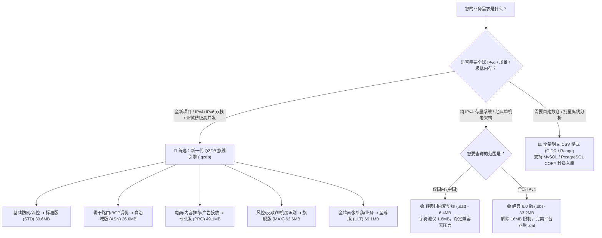

# qqzeng-ip 版本选型指南与全规格对照参考 (2026 年 11 月最新版)

> 本文档面向技术负责人、系统架构师及开发集成人员，为您提供 **qqzeng-ip** 各版本在 **文件体积、数据行数、检索性能、技术架构** 等维度的全面横向对比，帮助您在实际业务场景中做出最优的技术选型。

---

## 🧭 一分钟快速选型决策树



---

## 一、新一代旗舰版 QZDB（推荐全业务采用）

QZDB 专为现代微服务与云原生架构设计，单文件整合 **IPv4 + IPv6 全量双栈（超 1,250 万网段）**，采用 **PATRICIA Trie + 拓扑后序离线去重（Hash-Consing）** 压缩技术，实现了惊人的压缩比与单机千万级 QPS。

### 1. 全球双栈版（IPv4 + IPv6 综合规格）

| 版本规格 | 字段维度 | 对应 CSV 大小 | CSV 物理行数 | QZDB 二进制大小 | 压缩比 | 适用场景 |
| :--- | :---: | :---: | :---: | :---: | :---: | :--- |
| **标准版 (STD)** | 6 字段 | 728.2 MB | 1,183 万行 | **39.6 MB** | **18 : 1** | Web 高并发访问控制、黑白名单、粗粒度省市解析 |
| **自治域版 (ASN)** | 8 字段 | 579.5 MB | 638 万行 | **26.6 MB** | **22 : 1** | BGP 流量调度、跨运营商骨干优化、CDN 节点调度 |
| **专业版 (PRO)** | 11 字段 | 1,469.0 MB | 1,217 万行 | **49.1 MB** | **30 : 1** | 电商本地化、高精度广告分发、地级市与区县下沉 |
| **旗舰版 (MAX)** | 15 字段 | 2,091.1 MB | 1,250 万行 | **62.6 MB** | **33 : 1** | 业务风控、欺诈识别、宽带/数据中心/基站场景识别 |
| **至尊版 (ULT)** | **25 字段** | **2,939.0 MB** | **1,250 万行** | **69.1 MB** | **42 : 1** | 出海跨国业务、中英双语、电话前缀、货币、全维画像 |

### 2. 国内精华双栈版（专为国内业务打造）

| 版本规格 | 字段维度 | 对应 CSV 大小 | CSV 物理行数 | QZDB 二进制大小 | 典型微秒延迟 | 适用场景 |
| :--- | :---: | :---: | :---: | :---: | :---: | :--- |
| **标准版 (STD)** | 6 字段 | 29.8 MB | 51.0 万行 | **2.9 MB** | 0.05 µs (50ns) | 极速国内省市轻量过滤 |
| **自治域版 (ASN)** | 8 字段 | 38.7 MB | 38.5 万行 | **2.6 MB** | 0.05 µs (50ns) | 三大运营商互联互通、穿透专线识别 |
| **专业版 (PRO)** | 11 字段 | 99.7 MB | 85.3 万行 | **5.0 MB** | 0.08 µs (80ns) | 国内地级市 + 区县精细定位 |
| **旗舰版 (MAX)** | 15 字段 | 150.4 MB | 87.6 万行 | **5.9 MB** | 0.10 µs (100ns) | 场景推导（家宽/基站WiFi/教育网/商用） |
| **至尊版 (ULT)** | **25 字段** | **201.2 MB** | **87.6 万行** | **6.3 MB** | 0.12 µs (120ns) | 全维度国内最全标签库（含邮编、区号、经纬度） |

---

## 二、 各版本字段详细规格与属性说明

各版本字段体系遵循**单调递增设计**（`标准版 ⊂ 专业版 ⊂ 旗舰版 ⊂ 至尊版`；`ASN版` 为独立网络专项版）。CSV 明文首列为 `cidr`，随后紧跟各维度字段；QZDB SDK 则直接通过强类型属性或映射字典访问。

### 1. 五大版本字段覆盖矩阵 (Field Coverage Matrix)

| 字段类别 | 字段标识 (Key) | 中文字段名 | 标准版<br>(6维) | 专业版<br>(11维) | 旗舰版<br>(15维) | ASN版<br>(8维) | 至尊版<br>(25维) |
| :--- | :--- | :--- | :---: | :---: | :---: | :---: | :---: |
| **基础地理** | `continent` | 大洲中文 | ✅ | ✅ | ✅ | ✅ | ✅ |
| | `country_code` | 国家二字码 (ISO) | ✅ | ✅ | ✅ | ✅ | ✅ |
| | `country` | 国家中文名 | ✅ | ✅ | ✅ | ✅ | ✅ |
| | `province` | 省份 / 一级行政区 | ✅ | ✅ | ✅ | — | ✅ |
| | `city` | 地级市 / 城市 | ✅ | ✅ | ✅ | — | ✅ |
| **基础运营商**| `isp` | 运营商 / 机构名 | ✅ | ✅ | ✅ | ✅ | ✅ |
| **精细地理** | `district` | 区县级行政区 | — | ✅ | ✅ | — | ✅ |
| | `geo_id` | 行政区划代码 (国标) | — | ✅ | ✅ | — | ✅ |
| | `longitude` | 经度 (WGS84) | — | ✅ | ✅ | — | ✅ |
| | `latitude` | 纬度 (WGS84) | — | ✅ | ✅ | — | ✅ |
| | `timezone` | IANA 时区标识 | — | ✅ | ✅ | — | ✅ |
| **网络与场景**| `asn` | 自治域 ASN 编号 | — | — | ✅ | ✅ | ✅ |
| | `as_name` | 自治域注册组织名 | — | — | ✅ | ✅ | ✅ |
| | `as_domain` | 自治域官方主域名 | — | — | ✅ | ✅ | ✅ |
| | `usage_type` | 应用场景分类 | — | — | ✅ | ✅ | ✅ |
| **出海与国际化**| `continent_en` | 大洲英文名 | — | — | — | — | ✅ |
| | `country_alpha3` | 国家三字码 (ISO) | — | — | — | — | ✅ |
| | `country_en` | 国家英文名 | — | — | — | — | ✅ |
| | `province_en` | 省份英文名 | — | — | — | — | ✅ |
| | `city_en` | 城市英文名 | — | — | — | — | ✅ |
| | `district_en` | 区县英文名 | — | — | — | — | ✅ |
| | `languages` | 官方主要语言码 | — | — | — | — | ✅ |
| | `currency_code` | 法定货币三字码 | — | — | — | — | ✅ |
| | `phone_prefix` | 国际电话区号 | — | — | — | — | ✅ |
| | `emoji_flag` | 国旗 Emoji 符号 | — | — | — | — | ✅ |

---

### 2. 全要素 25 维属性参考字典 (Field Data Dictionary)

下表以中国深圳某典型电信 IPv4 节点（`113.108.181.0/24`）为例，演示至尊版 25 维全要素数据：

| 序号 | 字段标识 (Key) | 字段名称 | 标准取值示例 | 典型应用场景与说明 |
|:---:| :--- | :--- | :--- | :--- |
| 1 | `continent` | 大洲中文 | `亚洲` | 跨国大区粗粒度分流与访问限制 |
| 2 | `continent_en` | 大洲英文 | `Asia` | 出海系统多语言展示 |
| 3 | `country_code` | 国家二字码 | `CN` | ISO 3166-1 Alpha-2 标准代码，国际通用 |
| 4 | `country_alpha3` | 国家三字码 | `CHN` | ISO 3166-1 Alpha-3 标准代码，海关/外贸系统 |
| 5 | `country` | 国家中文名 | `中国` | 中文前端界面与统计分析 |
| 6 | `country_en` | 国家英文名 | `China` | 英文前端界面与海外合规上报 |
| 7 | `province` | 省份 / 州 | `广东省` | 国内各省份业务核算与分流 |
| 8 | `province_en` | 省份英文 | `Guangdong` | 国际收单、英文账单地址 |
| 9 | `city` | 地级市 | `深圳市` | 城市级本地生活推荐、广告精准投放 |
| 10 | `city_en` | 城市英文 | `Shenzhen` | 跨国出海系统本地化 |
| 11 | `district` | 区县行政区 | `南山区` | 最后一公里高精度商圈营销、网格化管理 |
| 12 | `district_en` | 区县英文 | `Nanshan` | 英文精细地址解析 |
| 13 | `geo_id` | 行政区划代码 | `440305` | 中华人民共和国国家统计局 6 位标准区划码 |
| 14 | `longitude` | 经度 | `113.93041` | WGS84 坐标系（地图可视化、测距打点） |
| 15 | `latitude` | 纬度 | `22.53303` | WGS84 坐标系 |
| 16 | `timezone` | IANA 时区 | `Asia/Shanghai` | 标准时区字符串（时差换算、本地时间校准） |
| 17 | `languages` | 官方语言 | `zh-CN` | 自动匹配应用默认语言环境 |
| 18 | `currency_code`| 货币代码 | `CNY` | ISO 4217 货币代码（智能展示本地结算货币） |
| 19 | `phone_prefix` | 国际区号 | `86` | 注册登录自动填充手机国际区号 |
| 20 | `emoji_flag` | 国旗 Emoji | `🇨🇳` | 界面优雅直观展示国籍符号 |
| 21 | `isp` | 运营商 | `中国电信` | 路由调度、运营商专线免流、穿透多线判断 |
| 22 | `asn` | 自治域编号 | `4134` | BGP 骨干路由归属、互联互通拓扑分析 |
| 23 | `as_name` | 自治域名 | `CHINANET-BACKBONE` | APNIC/RIPE 官方登记组织标识 |
| 24 | `as_domain` | 官方主域名 | `chinatelecom.cn` | 自治域主体企业官方域名验证 |
| 25 | `usage_type` | 应用场景 | `Broadband` | 业务风控与防刷核心（宽带/机房/移动/云厂商） |

> 💡 **使用场景 (`usage_type`) 枚举说明**：
> - `Broadband`（民用家庭宽带）
> - `Mobile`（蜂窝移动基站网络）
> - `DataCenter`（机房 / IDC 托管段）
> - `Cloud`（主流公有云主机，如 AWS/阿里云/腾讯云）
> - `Enterprise`（政企 / 商业专线）
> - `Education`（高校与科研教育网）
> - `Anycast`（全网广播 / 骨干 CDN 加速节点）
> - `Crawler`（合规商业搜索引擎爬虫）

---

## 三、经典老版纯 IPv4 架构（存量维护参考）

针对使用旧版 SDK（如 `.dat`、`.db`）的存量生产环境，各格式数据边界与规格对比如下：

| 架构 / 文件格式 | 适用版本 | 202611 记录行数 | 二进制文件大小 | 格式上限说明与建议 |
| :--- | :--- | :---: | :---: | :--- |
| **经典 2.0 格式 (`.dat`)** | **国内精华版** | 641,845 行 (CIDR)<br>412,192 行 (Range) | **6.4 MB** | 🟢 **推荐继续使用**<br>字符池仅 1.6MB，距 16MB 物理寻址上限有很大裕量，可永久平滑维护。 |
| **经典 2.0 格式 (`.dat`)** | **全球旗舰版** | 2,915,407 行 (CIDR)<br>1,818,504 行 (Range) | **36.9 MB** | ⚠️ **物理超限（不推荐）**<br>因全球字符池达 16.9MB，超过 24-bit（16MB）寻址限制，会导致高位溢出。 |
| **经典 6.0 格式 (`.db`)** | **全球旗舰版** | 2,915,407 节点 | **33.2 MB** | 🟢 **存量推荐升级（完美替代）**<br>彻底解除 16MB 限制，返回字段与 `.dat` 完全一致，代码仅换类名。 |
| **全量明文格式 (`.csv`)** | **全球旗舰版** | 2,915,407 行 | **275.5 MB** | 适用于自建 MySQL / PG 实体表直接存储。 |

---

## 四、 为什么建议全面升级至 QZDB？（三大质的飞跃）

```
[传统纯文本 CSV]       ████████████████████████████████████████ 2,939 MB
[经典老版二进制 .dat]   ████ 37 MB (受限 16MB 寻址极限，不支持 IPv6)
[新一代至尊版 QZDB]    █ 69 MB (整合 1,250 万 IPv4+IPv6 双栈，支持 mmap)
```

### 1. 空间与内存占用减少 40 倍
- **传统文本/数仓**：将全球 1,250 万条数据全部导入 MySQL 或 Redis，常驻内存通常需要 **3GB ~ 6GB**，冷启动加载漫长；
- **QZDB 引擎**：单文件仅 **69 MB**，支持操作系统的 `mmap`（内存映射技术），物理内存按需分页加载，**0 内存堆分配、秒级冷启动**。

### 2. 告别字段拼接与换行符错位
- **旧版痛点**：旧版返回类似 `亚洲|中国|北京|北京...` 单行字符串，调用方需要手工 `explode('|', $str)`，一旦遇到换行符或空列极易产生列偏移 Bug；
- **QZDB 体验**：SDK 原生提供**强类型对象模型与字典映射**（如 `info.country_code`、`info.isp`、`info.asn`），字段语义一清二楚，从根源绝杜绝解析错位。

### 3. 多语言工业级生态（开箱即用）
官方统一维护 **8 大主流语言 SDK**，遵循无锁只读并发标准：
- **编译型语言 (C / C++ / Go / Rust)**：极速压测吞吐达 **5,000 万 ~ 8,000 万 QPS**；
- **企业托管语言 (Java / C# .NET)**：支持堆外直接映射与零 GC 优化；
- **脚本与微服务 (Node.js / PHP / Python)**：零 C 扩展纯语言平替，完美兼容 Swoole、Workerman、PHP-FPM、FastAPI 等现代架构。

---

## 五、 性能测试比较与评测白皮书

为了让技术选型更加透明客观，官方提供统一硬件环境（Apple M4 Max）下的压测跑分与行业横评：

### 1. 8 大主流语言 QPS 性能一览（单线程 vs 16 线程）

| 语言与阵营 | 单线程整型随机 (口径 A) | 16 线程并发极限 (口径 B) | 字符串直查 (含IP解析) | 架构技术亮点 |
| :--- | ---: | ---: | ---: | :--- |
| 👑 **C / C++** | **96.5 M/s** | **506 M/s** | 12.6 M/s | 零拷贝 mmap，极度轻量，单头文件直接内嵌 |
| ⚡ **Go** | **97.3 M/s** | **719 M/s** | 12.1 M/s | 原生 Goroutine 无锁并发，微服务与云原生首选 |
| 🛡️ **Rust** | **82.6 M/s** | **233 M/s** | 11.5 M/s | 内存安全，值语义与 4 路组相联缓存 |
| ☕ **Java** | **48.1 M/s** | **136 M/s** | 11.9 M/s | 堆外内存直接映射，高并发下 0 GC 停顿 |
| 🚀 **C# (.NET)** | **46.9 M/s** | **550 M/s** | 20.9 M/s | 原生内存映射加速，字符串全链路解析领跑 |
| 🟢 **Node.js** | **8.22 M/s** | 进程池扩展 | 10.3 M/s | BigInt 极速偏移计算，JS 生态极速档 |
| 🐘 **PHP** | **5.67 M/s** | FPM / Swoole | 470 K/s | 纯 PHP 零扩展依赖，自带双模式内存缓冲 |
| 🐍 **Python** | **1.30 M/s** | 多进程扩展 | 273 K/s | 零三方依赖，数据分析与快速自动化 |

> 📖 **完整性能文档直达**：
> - 想要了解各语言压测口径、复现命令与完整指标，请参阅：[`PERFORMANCE.md`](./PERFORMANCE.md)
> - 想要对比 QZDB 与 MaxMind GeoIP2、ip2region xdb、经典 .dat 的架构横评，请参阅：[`BENCHMARK_COMPARISON.md`](./BENCHMARK_COMPARISON.md)

---

## 六、 版本功能与架构横向速查表

| 功能特性 / 维度 | 经典版 (.dat) | 经典版 (.db) | QZDB 标准版 | QZDB 专业版 | QZDB 至尊版 |
| :--- | :---: | :---: | :---: | :---: | :---: |
| **支持 IPv4** | ✅ | ✅ | ✅ | ✅ | ✅ |
| **支持 IPv6 (双栈)** | ❌ | ❌ | ✅ | ✅ | ✅ |
| **最大容量限制** | ⚠️ 16MB 字符上限 | 24-bit 节点限制 | 无限制 | 无限制 | 无限制 |
| **省份 / 城市** | ✅ | ✅ | ✅ | ✅ | ✅ |
| **区县级下沉** | ✅ | ✅ | ❌ | ✅ | ✅ |
| **经度 / 纬度 / 时区** | ✅ | ✅ | ❌ | ✅ | ✅ |
| **ASN 编号 / 自治域名称** | ❌ | ❌ | ❌ | ❌ (旗舰MAX有) | ✅ |
| **应用场景识别 (Broadband/DC)** | ❌ | ❌ | ❌ | ❌ (旗舰MAX有) | ✅ |
| **多语言英文名 / 语言 / 货币** | ❌ | ❌ | ❌ | ❌ | ✅ |
| **国家简码 (CN / US / JP)** | ⚠️ 文本索引解析 | ⚠️ 文本索引解析 | ✅ 原生直取 | ✅ 原生直取 | ✅ (含三位码) |
| **mmap 共享内存支持** | ❌ | ❌ | ✅ | ✅ | ✅ |

---

> 💡 **集成建议**：如果您目前正在评估或使用老版数据，推荐直接在官方试用中心下载 `demo.qzdb` 进行体验，只需 3 行代码即可完成无缝平替！
