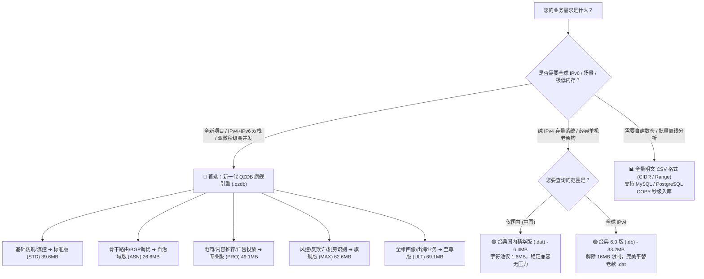

# qqzeng-ip 版本选型指南与全规格对照参考 (2026 年 11 月最新版)

> 本文档面向技术负责人、系统架构师及开发集成人员，为您提供 **qqzeng-ip** 各版本在 **文件体积、数据行数、检索性能、技术架构** 等维度的全面横向对比，帮助您在实际业务场景中做出最优的技术选型。

---

## 🧭 一分钟快速选型决策树



---

## 一、新一代旗舰版 QZDB（推荐全业务采用）

QZDB 专为现代微服务与云原生架构设计，单文件整合 **IPv4 + IPv6 全量双栈（超 1,250 万网段）**，采用 **PATRICIA Trie + 拓扑后序离线去重（Hash-Consing）** 压缩技术，实现了惊人的压缩比与单机千万级 QPS。

### 1. 全球双栈版（IPv4 + IPv6 综合规格）

| 版本规格 | 字段维度 | 对应 CSV 大小 | CSV 物理行数 | QZDB 二进制大小 | 压缩比 | 适用场景 |
| :--- | :---: | :---: | :---: | :---: | :---: | :--- |
| **标准版 (STD)** | 6 字段 | 728.2 MB | 1,183 万行 | **39.6 MB** | **18 : 1** | Web 高并发访问控制、黑白名单、粗粒度省市解析 |
| **自治域版 (ASN)** | 8 字段 | 579.5 MB | 638 万行 | **26.6 MB** | **22 : 1** | BGP 流量调度、跨运营商骨干优化、CDN 节点调度 |
| **专业版 (PRO)** | 11 字段 | 1,469.0 MB | 1,217 万行 | **49.1 MB** | **30 : 1** | 电商本地化、高精度广告分发、地级市与区县下沉 |
| **旗舰版 (MAX)** | 15 字段 | 2,091.1 MB | 1,250 万行 | **62.6 MB** | **33 : 1** | 业务风控、欺诈识别、宽带/数据中心/基站场景识别 |
| **至尊版 (ULT)** | **25 字段** | **2,939.0 MB** | **1,250 万行** | **69.1 MB** | **42 : 1** | 出海跨国业务、中英双语、电话前缀、货币、全维画像 |

### 2. 国内精华双栈版（专为国内业务打造）

| 版本规格 | 字段维度 | 对应 CSV 大小 | CSV 物理行数 | QZDB 二进制大小 | 典型微秒延迟 | 适用场景 |
| :--- | :---: | :---: | :---: | :---: | :---: | :--- |
| **标准版 (STD)** | 6 字段 | 29.8 MB | 51.0 万行 | **2.9 MB** | 0.05 µs (50ns) | 极速国内省市轻量过滤 |
| **自治域版 (ASN)** | 8 字段 | 38.7 MB | 38.5 万行 | **2.6 MB** | 0.05 µs (50ns) | 三大运营商互联互通、穿透专线识别 |
| **专业版 (PRO)** | 11 字段 | 99.7 MB | 85.3 万行 | **5.0 MB** | 0.08 µs (80ns) | 国内地级市 + 区县精细定位 |
| **旗舰版 (MAX)** | 15 字段 | 150.4 MB | 87.6 万行 | **5.9 MB** | 0.10 µs (100ns) | 场景推导（家宽/基站WiFi/教育网/商用） |
| **至尊版 (ULT)** | **25 字段** | **201.2 MB** | **87.6 万行** | **6.3 MB** | 0.12 µs (120ns) | 全维度国内最全标签库（含邮编、区号、经纬度） |

---

## 二、经典老版纯 IPv4 架构（存量维护参考）

针对使用旧版 SDK（如 `.dat`、`.db`）的存量生产环境，各格式数据边界与规格对比如下：

| 架构 / 文件格式 | 适用版本 | 202611 记录行数 | 二进制文件大小 | 格式上限说明与建议 |
| :--- | :--- | :---: | :---: | :--- |
| **经典 2.0 格式 (`.dat`)** | **国内精华版** | 641,845 行 (CIDR)<br>412,192 行 (Range) | **6.4 MB** | 🟢 **推荐继续使用**<br>字符池仅 1.6MB，距 16MB 物理寻址上限有很大裕量，可永久平滑维护。 |
| **经典 2.0 格式 (`.dat`)** | **全球旗舰版** | 2,915,407 行 (CIDR)<br>1,818,504 行 (Range) | **36.9 MB** | ⚠️ **物理超限（不推荐）**<br>因全球字符池达 16.9MB，超过 24-bit（16MB）寻址限制，会导致高位溢出。 |
| **经典 6.0 格式 (`.db`)** | **全球旗舰版** | 2,915,407 节点 | **33.2 MB** | 🟢 **存量推荐升级（完美替代）**<br>彻底解除 16MB 限制，返回字段与 `.dat` 完全一致，代码仅换类名。 |
| **全量明文格式 (`.csv`)** | **全球旗舰版** | 2,915,407 行 | **275.5 MB** | 适用于自建 MySQL / PG 实体表直接存储。 |

---

## 三、为什么建议全面升级至 QZDB？（三大质的飞跃）

```
[传统纯文本 CSV]       ████████████████████████████████████████ 2,939 MB
[经典老版二进制 .dat]   ████ 37 MB (受限 16MB 寻址极限，不支持 IPv6)
[新一代至尊版 QZDB]    █ 69 MB (整合 1,250 万 IPv4+IPv6 双栈，支持 mmap)
```

### 1. 空间与内存占用减少 40 倍
- **传统文本/数仓**：将全球 1,250 万条数据全部导入 MySQL 或 Redis，常驻内存通常需要 **3GB ~ 6GB**，冷启动加载漫长；
- **QZDB 引擎**：单文件仅 **69 MB**，支持操作系统的 `mmap`（内存映射技术），物理内存按需分页加载，**0 内存堆分配、秒级冷启动**。

### 2. 告别字段拼接与换行符错位
- **旧版痛点**：旧版返回类似 `亚洲|中国|北京|北京...` 单行字符串，调用方需要手工 `explode('|', $str)`，一旦遇到换行符或空列极易产生列偏移 Bug；
- **QZDB 体验**：SDK 原生提供**强类型对象模型与字典映射**（如 `info.country_code`、`info.isp`、`info.asn`），字段语义一清二楚，从根源绝杜绝解析错位。

### 3. 多语言工业级生态（开箱即用）
官方统一维护 **8 大主流语言 SDK**，遵循无锁只读并发标准：
- **编译型语言 (C / C++ / Go / Rust)**：极速压测吞吐达 **5,000 万 ~ 8,000 万 QPS**；
- **企业托管语言 (Java / C# .NET)**：支持堆外直接映射与零 GC 优化；
- **脚本与微服务 (Node.js / PHP / Python)**：零 C 扩展纯语言平替，完美兼容 Swoole、Workerman、PHP-FPM、FastAPI 等现代架构。

---

## 四、版本功能对照速查表

| 功能特性 / 维度 | 经典版 (.dat) | 经典版 (.db) | QZDB 标准版 | QZDB 专业版 | QZDB 至尊版 |
| :--- | :---: | :---: | :---: | :---: | :---: |
| **支持 IPv4** | ✅ | ✅ | ✅ | ✅ | ✅ |
| **支持 IPv6 (双栈)** | ❌ | ❌ | ✅ | ✅ | ✅ |
| **最大容量限制** | ⚠️ 16MB 字符上限 | 24-bit 节点限制 | 无限制 | 无限制 | 无限制 |
| **省份 / 城市** | ✅ | ✅ | ✅ | ✅ | ✅ |
| **区县级下沉** | ✅ | ✅ | ❌ | ✅ | ✅ |
| **经度 / 纬度 / 时区** | ✅ | ✅ | ❌ | ✅ | ✅ |
| **ASN 编号 / 自治域名称** | ❌ | ❌ | ❌ | ❌ (旗舰MAX有) | ✅ |
| **应用场景识别 (Broadband/DC)** | ❌ | ❌ | ❌ | ❌ (旗舰MAX有) | ✅ |
| **多语言英文名 / 语言 / 货币** | ❌ | ❌ | ❌ | ❌ | ✅ |
| **国家简码 (CN / US / JP)** | ⚠️ 文本索引解析 | ⚠️ 文本索引解析 | ✅ 原生直取 | ✅ 原生直取 | ✅ (含三位码) |
| **mmap 共享内存支持** | ❌ | ❌ | ✅ | ✅ | ✅ |

---

> 💡 **集成建议**：如果您目前正在评估或使用老版数据，推荐直接在官方试用中心下载 `demo.qzdb` 进行体验，只需 3 行代码即可完成无缝平替！
